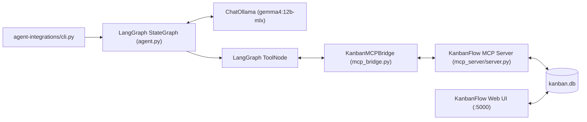

# Agent Integrations Guide (LangChain + LangGraph + Ollama + MCP)

KanbanFlow includes a local AI agent in [`agent-integrations/`](../agent-integrations/) built with **LangChain** and **LangGraph**, powered by local **Ollama** (`gemma4:12b-mlx`), and connected to the project's **MCP stdio server** (`mcp_server/server.py`).

For the full standalone package README inside the folder, see [`agent-integrations/README.md`](../agent-integrations/README.md).

---

## Overview



### Key Capabilities
- **100% Local Execution:** Uses local Ollama (`gemma4:12b-mlx`) over `http://127.0.0.1:11434` and local MCP stdio communication — zero cloud API keys required.
- **Full MCP Tool Access:** Automatically loads all 12 KanbanFlow MCP tools (`create_task`, `get_board`, `list_columns`, `list_tasks`, `get_task`, `update_task`, `move_task`, `delete_task`, `list_archived_tasks`, `archive_task`, `archive_done_tasks`, `restore_task`).
- **Multi-Step LangGraph Reasoning:** Loops `agent -> tools -> agent` to execute chained operations (e.g., creating a `blocker` task, capturing its ID, and creating a `blocked` task referencing `blocker_ids`).
- **Multi-Turn Memory:** Uses LangGraph's `InMemorySaver` checkpointer so follow-up commands can update or move tasks created earlier in the chat.
- **Live Board Sync:** Writes directly to the shared `kanban.db` SQLite database used by `app.py`.

---

## Quick Start: Starting the Agent

### 1. Prepare Ollama & `gemma4:12b-mlx`

```bash
# Ensure Ollama is running
ollama serve

# Pull the local model (in another terminal)
ollama pull gemma4:12b-mlx

# Verify installation
ollama list
```

### 2. Install Agent Dependencies (Isolated Virtual Environment)

```bash
# From the repository root
python3.14 -m venv agent-integrations/.venv
agent-integrations/.venv/bin/pip install -r agent-integrations/requirements.txt
```

### 3. Run the Preflight Health Check

```bash
agent-integrations/.venv/bin/python agent-integrations/cli.py --check
```

This checks:
1. That `mcp_server/server.py` launches over stdio, returns all 12 tools, and opens `kanban.db`.
2. That Ollama is reachable at `http://127.0.0.1:11434` and `gemma4:12b-mlx` is pulled.

### 4. Start the KanbanFlow Web App (Terminal 1) & Agent (Terminal 2)

```bash
# Terminal 1: Web UI at http://127.0.0.1:5000
.venv/bin/python app.py

# Terminal 2: Interactive LangGraph Agent (with tool call traces)
agent-integrations/.venv/bin/python agent-integrations/cli.py --verbose
```

---

## Creating Tasks from the Agent to the Kanban Board

### Method 1: Interactive Chat

Once inside `you>`, describe the card(s) you want created:

```text
you> Create a high-priority task in Backlog titled "Add rate limiting to REST API" due 2026-12-20.
Include acceptance criteria:
- Return HTTP 429 with Retry-After header when exceeded
- Allow configurable burst limits per IP
And definition of done:
- Automated unit tests added
- Swagger docs updated
```

Use `/board` at any time in the prompt to view the updated columns and task IDs, or refresh [http://127.0.0.1:5000](http://127.0.0.1:5000) to see the card on the board.

### Method 2: Single-Shot CLI Command

```bash
agent-integrations/.venv/bin/python agent-integrations/cli.py \
  --verbose \
  --prompt "Create an urgent blocker task in In Progress titled 'Provision Redis cluster', then create a high-priority blocked task in Backlog titled 'Enable session caching' blocked by it."
```

### Method 3: Safe Sandbox Testing (`--temp-db`)

Experiment without modifying your workspace's `kanban.db`:

```bash
agent-integrations/.venv/bin/python agent-integrations/cli.py --temp-db --verbose
```

---

## Configuration & Environment Variables

| Variable | Default | Description |
| --- | --- | --- |
| `OLLAMA_MODEL` | `gemma4:12b-mlx` | Ollama model name |
| `OLLAMA_BASE_URL` | `http://127.0.0.1:11434` | Ollama HTTP base URL |
| `OLLAMA_TEMPERATURE` | `0.2` | Sampling temperature |
| `OLLAMA_NUM_CTX` | *(model default)* | Optional context window size (e.g., `8192` or `16384`) |
| `KANBAN_DB_PATH` | `<repo_root>/kanban.db` | Target SQLite database |
| `KANBAN_MCP_SERVER_SCRIPT` | `<repo_root>/mcp_server/server.py` | MCP stdio server script path |
| `KANBAN_MCP_PYTHON` | Current Python executable | Python binary used to spawn the MCP server |
| `AGENT_RECURSION_LIMIT` | `20` | Max LangGraph execution steps per turn |

---

## Running Automated Agent Tests

```bash
agent-integrations/.venv/bin/python -m unittest discover -s agent-integrations -v
```

See [`agent-integrations/README.md`](../agent-integrations/README.md) for programmatic Python usage, interactive slash commands, full CLI flags, and troubleshooting.
