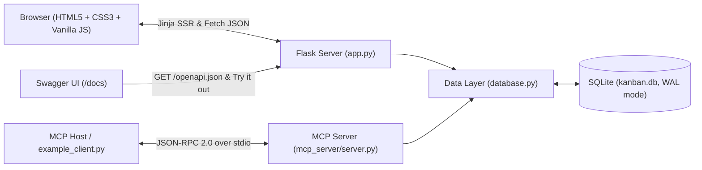
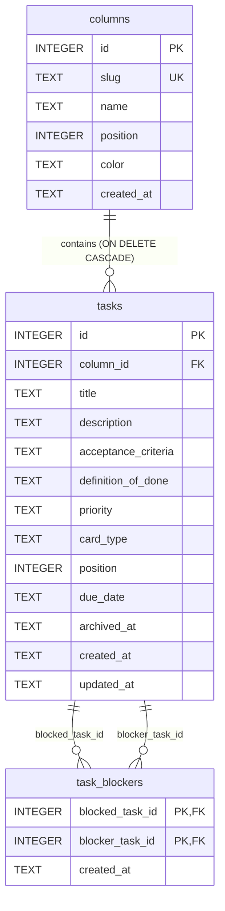

# Architecture & Database Design

KanbanFlow follows a clean, layered architecture with SQLite as the single source of truth shared by the Flask web server and the MCP stdio server.

---

## Project Directory Layout

```text
kanban-try-agy/
├── app.py                   # Flask application factory, Jinja routes, REST API, Swagger & /healthz
├── database.py              # SQLite context manager, schema migrations, CRUD & dependency logic
├── openapi_spec.py          # OpenAPI 3.1.0 specification generator
├── schema.sql               # Canonical SQLite DDL (tables & indexes)
├── requirements.txt         # Runtime dependencies (Flask, Gunicorn)
├── Dockerfile               # Multi-stage non-root container image for Kubernetes
├── .dockerignore            # Docker build context exclusions
├── templates/
│   ├── base.html            # Base HTML5 shell (fonts, favicon, zero-flash theme script)
│   ├── index.html           # Kanban board, Create/Edit modal, Archive slide-over drawer
│   └── swagger.html         # Branded Swagger UI page loading /openapi.json
├── static/
│   ├── css/style.css        # Light/dark themes, typography system, card/modal/drawer styles
│   └── js/app.js            # Vanilla JS controller (Fetch API, DnD, spotlight SVG overlay, checklists)
├── mcp_server/
│   ├── __init__.py
│   ├── server.py            # JSON-RPC 2.0 MCP stdio server (12 tools, 3 resources)
│   ├── example_client.py    # Reusable KanbanMCPClient + runnable lifecycle demo
│   └── README.md            # Quick MCP reference
├── k8s/
│   └── deployment.yaml      # Kubernetes PVC, Deployment (Recreate, non-root), and Service
├── tests/
│   ├── test_app.py          # REST API, SSR, Archive, AC/DoD, migration & OpenAPI tests
│   └── test_mcp.py          # End-to-end stdio MCP server & client tests
└── Docs/                    # Project documentation
```

---

## High-Level Data Flow



---

## SQLite Schema

Defined in `schema.sql` with `PRAGMA foreign_keys = ON`, `PRAGMA journal_mode = WAL`, and `PRAGMA busy_timeout = 5000`.

### Entity Relationship



### Table Notes

- **`columns`:** Seeded automatically on first initialization with `backlog`, `in_progress`, `review`, and `done`.
- **`tasks`:**
  - `priority`: `low` | `medium` | `high` | `urgent` (CHECK constraint).
  - `card_type`: `task` | `blocked` | `blocker` (CHECK constraint).
  - `acceptance_criteria` & `definition_of_done`: Newline-delimited text; completed checklist lines are prefixed with `[x] `.
  - `archived_at`: `NULL` for active board cards, ISO-8601 UTC timestamp for archived cards.
  - `position`: Contiguous 0-based ordering within each active column, resequenced atomically on move, delete, archive, and restore.
- **`task_blockers`:** Join table preventing self-links (`CHECK (blocked_task_id != blocker_task_id)`). When a card is linked as a blocker/blocked target, `database.py` automatically promotes standard (`task`) targets to `blocker` / `blocked` and cascades deletes cleanly.

---

## Automatic Migrations

`database.init_db()` runs safely on every startup (web server and MCP server):
1. Inspects `PRAGMA table_info(tasks)` on existing databases.
2. Applies `ALTER TABLE` automatically if `card_type`, `archived_at`, `acceptance_criteria`, or `definition_of_done` are missing.
3. Executes `schema.sql` (`CREATE TABLE IF NOT EXISTS` / `CREATE INDEX IF NOT EXISTS`).
4. Seeds default columns (and starter tasks with a linked Blocked/Blocker example) **only** when `columns` is empty.
