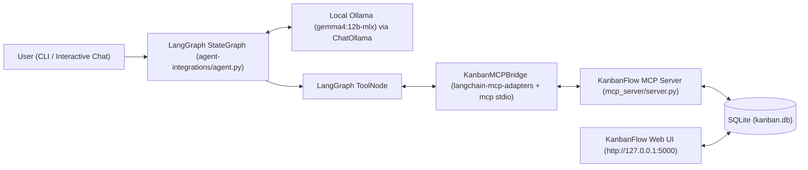

# KanbanFlow AI Agent Integration (LangChain + LangGraph + Ollama + MCP)

A local AI agent built with **LangChain** and **LangGraph**, powered by a local **Ollama** model (`gemma4:12b-mlx`), that connects directly to KanbanFlow's **Model Context Protocol (MCP)** stdio server (`mcp_server/server.py`) to create, inspect, update, link, move, and archive tasks on your Kanban board.

Because both Ollama and the KanbanFlow MCP server run 100% locally, no external API keys or cloud services are required.

---

## Architecture



### How It Works
1. **`agent-integrations/mcp_bridge.py` (`KanbanMCPBridge`)** spawns `mcp_server/server.py` as a local stdio subprocess, performs the MCP JSON-RPC 2.0 handshake, and loads all **12 KanbanFlow MCP tools** as LangChain `BaseTool` instances via `langchain-mcp-adapters`.
2. **`agent-integrations/agent.py` (`build_kanban_agent`)** compiles a **LangGraph `StateGraph`** with:
   - An `agent` node backed by `ChatOllama(model="gemma4:12b-mlx")` bound to the MCP tools.
   - A `tools` node (`langgraph.prebuilt.ToolNode`) executing MCP tool calls against `mcp_server/server.py`.
   - Conditional routing (`tools_condition`) looping `agent -> tools -> agent` for multi-step workflows (for example, creating a `blocker` card first and then creating a `blocked` card linked to its returned ID).
   - An `InMemorySaver` checkpointer preserving multi-turn conversation memory per `thread_id`.
3. **Shared SQLite Persistence:** Both `mcp_server/server.py` and the Flask web app (`app.py`) read and write the same `kanban.db` file (in SQLite WAL mode), so tasks created by the agent immediately appear on the Kanban board.

---

## Folder Contents

| File | Purpose |
| --- | --- |
| `config.py` | `AgentConfig` (defaults to `gemma4:12b-mlx`, `http://127.0.0.1:11434`, root `kanban.db`), env var loading, and Ollama health check |
| `mcp_bridge.py` | Async `KanbanMCPBridge` managing the stdio `mcp.ClientSession` and loading MCP tools into LangChain |
| `agent.py` | System prompt, `create_ollama_llm()`, LangGraph `StateGraph` (`build_kanban_agent`), and `run_agent_turn()` |
| `cli.py` | CLI entrypoint supporting preflight checks (`--check`), interactive chat, single-shot prompts (`--prompt`), verbose tool tracing (`--verbose`), and safe sandbox runs (`--temp-db`) |
| `requirements.txt` | Isolated Python dependencies (`langchain`, `langchain-ollama`, `langgraph`, `langchain-mcp-adapters`, `mcp`) |
| `test_agent.py` | Automated end-to-end tests verifying LangGraph + real `mcp_server/server.py` task creation and dependency linking |
| `README.md` | This guide |

---

## Prerequisites

1. **Python 3.11 – 3.14** (used for the isolated `agent-integrations/.venv` environment).
2. **Ollama** installed locally:
   - macOS (Homebrew): `brew install ollama`
   - Other platforms: download from [https://ollama.com](https://ollama.com)
3. **Pull the `gemma4:12b-mlx` model** and ensure the Ollama daemon is running:

```bash
# Start Ollama (skip if the Ollama macOS app or background service is already running)
ollama serve

# In another terminal, pull the local model
ollama pull gemma4:12b-mlx

# Confirm gemma4:12b-mlx is available locally
ollama list
```

---

## Installation & Setup

Keep the agent's dependencies in a dedicated virtual environment inside `agent-integrations/.venv` so the core Flask web server (`requirements.txt` / Docker image) stays lightweight:

```bash
# From the repository root (kanban-try-agy/)
python3.14 -m venv agent-integrations/.venv
source agent-integrations/.venv/bin/activate
pip install -r agent-integrations/requirements.txt
```

> **Note:** If you do not have `python3.14`, use `python3.12` or `python3.13` (any Python 3.11–3.14 interpreter). You can also invoke commands without activating the venv by calling `agent-integrations/.venv/bin/python ...` directly.

---

## How to Start the Agent

### Step 1 (Optional): Start the KanbanFlow Web Board
In a separate terminal, start the Flask web app so you can view tasks as the agent creates them:

```bash
# From the repository root
.venv/bin/python app.py
```

Open [http://127.0.0.1:5000](http://127.0.0.1:5000) in your browser.

### Step 2: Run the Preflight Check
Before starting a session, verify that **both** the KanbanFlow MCP server and Ollama (`gemma4:12b-mlx`) are healthy:

```bash
agent-integrations/.venv/bin/python agent-integrations/cli.py --check
```

Expected output when everything is ready:

```text
KanbanFlow Agent Preflight Check
========================================
Model:      gemma4:12b-mlx
Ollama URL: http://127.0.0.1:11434
MCP Server: /path/to/kanban-try-agy/mcp_server/server.py
SQLite DB:  /path/to/kanban-try-agy/kanban.db

[OK] MCP Server: kanbanflow-mcp v1.0.0 — 12 tools loaded
     Tools: get_board, list_columns, list_tasks, get_task, create_task, update_task, move_task, delete_task, list_archived_tasks, archive_task, archive_done_tasks, restore_task
     Board: 4 columns, 23 active tasks, 0 archived
[OK] Ollama: reachable at http://127.0.0.1:11434, model 'gemma4:12b-mlx' is available.
```

### Step 3: Launch the Agent

#### Option A: Interactive Multi-Turn Chat (Recommended)
```bash
agent-integrations/.venv/bin/python agent-integrations/cli.py
```

Add `--verbose` (`-v`) to print every MCP tool call and JSON response in real time:

```bash
agent-integrations/.venv/bin/python agent-integrations/cli.py --verbose
```

Built-in slash commands inside interactive chat:
- `/board` — Print a live summary of columns, WIP counts, and active tasks via the `kanban://board` MCP resource.
- `/tools` — List all 12 MCP tools loaded from `mcp_server/server.py`.
- `/clear` — Reset conversation history (starts a fresh LangGraph `thread_id`).
- `/help` — Display commands and sample prompts.
- `/exit` (or `Ctrl+C` / `Ctrl+D`) — Shut down the MCP server cleanly and exit.

#### Option B: Single-Shot Command Mode
Run one prompt, execute the MCP tool calls, print the confirmation, and exit:

```bash
agent-integrations/.venv/bin/python agent-integrations/cli.py \
  --verbose \
  --prompt "Create a high-priority task in backlog titled 'Add OAuth2 PKCE login' due 2026-12-15"
```

#### Option C: Safe Sandbox Mode (`--temp-db`)
Test prompts against a temporary SQLite database without touching your real `kanban.db`:

```bash
agent-integrations/.venv/bin/python agent-integrations/cli.py --temp-db --verbose
```

---

## How to Create Tasks from the Agent to the Kanban Board

When you describe a task in plain English, the LangGraph agent translates your request into one or more MCP `create_task` tool calls against `mcp_server/server.py`, writes directly to `kanban.db`, and reports back the newly assigned `#id` and card metadata.

### Example 1: Create a Simple Task in Backlog

**Single-shot:**
```bash
agent-integrations/.venv/bin/python agent-integrations/cli.py \
  --verbose \
  --prompt "Create a medium priority task in backlog titled 'Document backup restore drill' with description 'Write runbook and test restore on staging DB.'"
```

**What happens under the hood:**
1. `gemma4:12b-mlx` emits a `create_task` tool call with `title`, `column_slug="backlog"`, `priority="medium"`, and `description`.
2. LangGraph routes to `ToolNode`, which invokes `create_task` over stdio on `mcp_server/server.py`.
3. `mcp_server/server.py` inserts the card into `kanban.db` and returns the created task JSON (including its numeric `id`).
4. The agent summarizes the new card (e.g., `#25 Document backup restore drill` in `Backlog`).

---

### Example 2: Create a Rich Task with Acceptance Criteria, Definition of Done & Due Date

**Interactive chat:**
```text
you> Create a high-priority task in Backlog titled "Implement API rate limiting" due 2026-12-20.
Description: Protect public REST endpoints with token-bucket rate limits.
Acceptance Criteria:
- Return HTTP 429 with Retry-After header when limit is exceeded
- Configurable per-IP and per-token thresholds
Definition of Done:
- Unit and load tests passing
- OpenAPI spec and API docs updated
```

The agent calls `create_task` with newline-separated `acceptance_criteria` and `definition_of_done` strings. On the KanbanFlow web board, the card automatically renders interactive **AC 0/2** and **DoD 0/2** checklist pills.

---

### Example 3: Create Linked `blocker` and `blocked` Cards

KanbanFlow highlights dependencies with animated SVG connectors when a `blocked` card links to one or more `blocker` cards via `blocker_ids`.

**Interactive chat:**
```text
you> Create an urgent blocker task in In Progress titled "Provision staging Redis cluster".
Then create a high-priority blocked task in Backlog titled "Enable distributed session caching" that is blocked by it.
```

**Multi-step LangGraph execution:**
1. Turn step 1: The agent calls `create_task(title="Provision staging Redis cluster", column_slug="in_progress", priority="urgent", card_type="blocker")` -> receives e.g. `id: 26`.
2. Turn step 2: LangGraph loops the tool output back to `gemma4:12b-mlx`, which calls `create_task(title="Enable distributed session caching", column_slug="backlog", priority="high", card_type="blocked", blocker_ids=[26])`.
3. Turn step 3: The agent confirms both `#26` (Blocker) and `#27` (Blocked by `#26`).

Reload the web board and hover/pin either card to see the highlighted dependency frame and animated connector arrow.

---

### Example 4: Break Down a Feature into Multiple Cards

```text
you> Break down "Migrate authentication to passkeys" into 3 tasks in Backlog:
1. Database schema for WebAuthn credentials (high)
2. Backend registration & verification endpoints (high)
3. Frontend passkey enrollment UI (medium)
Include 2 acceptance criteria for each task.
```

---

### Example 5: Multi-Turn Follow-Up Edits & Column Moves

Because interactive mode uses LangGraph's `InMemorySaver` checkpointer, you can refer to tasks created earlier in the conversation:

```text
you> Move the Redis blocker task we just created to Review, and check off its first Definition of Done item.
```

The agent remembers the task ID from the previous turn and calls `update_task` / `move_task` via MCP.

---

### Example 6: Inspect & Triage Existing Board Tasks

```text
you> List all urgent or blocked tasks currently on the board and tell me which blockers are still not in Done.
```

---

### Verifying Created Tasks on the Kanban Board

1. **Web UI:** Open or refresh [http://127.0.0.1:5000](http://127.0.0.1:5000). Your new cards appear immediately in their target columns.
2. **Inside Agent Chat:** Run `/board` to view live column counts and recent card IDs directly from `kanban://board`.
3. **REST API:**
   ```bash
   curl -s http://127.0.0.1:5000/api/tasks | python3 -m json.tool
   ```

---

### Supported `create_task` Fields Reference

| Field | Required | Values / Format |
| --- | --- | --- |
| `title` | Yes | Short, descriptive card title |
| `column_slug` | No | `backlog` (default), `in_progress`, `review`, `done`, or any custom column slug |
| `column_id` | No | Numeric column ID (alternative to `column_slug`) |
| `priority` | No | `low`, `medium` (default), `high`, `urgent` |
| `card_type` | No | `task` (default), `blocker`, `blocked` |
| `description` | No | Detailed card description |
| `acceptance_criteria` | No | Newline-separated checklist items (prefix completed lines with `[x] `) |
| `definition_of_done` | No | Newline-separated checklist items (prefix completed lines with `[x] `) |
| `due_date` | No | ISO date `YYYY-MM-DD` |
| `blocker_ids` | No | List of integer task IDs blocking this card (for `card_type="blocked"`) |
| `blocking_ids` | No | List of integer task IDs blocked by this card (for `card_type="blocker"`) |

---

## Configuration Reference

### Environment Variables

| Variable | Default | Description |
| --- | --- | --- |
| `OLLAMA_MODEL` | `gemma4:12b-mlx` | Local Ollama model name used by `ChatOllama` |
| `OLLAMA_BASE_URL` | `http://127.0.0.1:11434` | Ollama HTTP API endpoint |
| `OLLAMA_TEMPERATURE` | `0.2` | Sampling temperature (lower = more reliable structured tool calls) |
| `OLLAMA_NUM_CTX` | *(model default)* | Optional context window override (e.g., `8192` or `16384`) |
| `KANBAN_DB_PATH` | `<repo_root>/kanban.db` | SQLite database shared with `app.py` and `mcp_server/server.py` |
| `KANBAN_MCP_SERVER_SCRIPT` | `<repo_root>/mcp_server/server.py` | Path to the KanbanFlow MCP stdio server |
| `KANBAN_MCP_PYTHON` | Current Python interpreter | Python executable used to spawn `mcp_server/server.py` |
| `KANBAN_SEED_SAMPLE_TASKS` | `1` | Set to `0` to prevent auto-seeding sample cards into a brand-new DB |
| `AGENT_RECURSION_LIMIT` | `20` | Maximum LangGraph steps per user turn |

### CLI Options

```text
python agent-integrations/cli.py [options] [prompt_words...]

  -p, --prompt TEXT        Run a single prompt and exit
  -m, --model TEXT         Override Ollama model (default: gemma4:12b-mlx)
  --ollama-url URL         Override Ollama base URL (default: http://127.0.0.1:11434)
  --temperature FLOAT      Sampling temperature (default: 0.2)
  --num-ctx INT            Optional Ollama context window size
  --db-path PATH           Target a specific SQLite DB file
  --temp-db                Use an isolated temporary SQLite DB
  --thread-id ID           LangGraph memory thread ID (default: interactive)
  -v, --verbose            Print MCP tool calls and JSON outputs on each turn
  --check                  Verify MCP server tools + Ollama model availability and exit
  --skip-health-check      Skip startup Ollama /api/tags check
```

---

## Programmatic Python Usage

```python
import asyncio
import sys
from pathlib import Path

sys.path.insert(0, str(Path("agent-integrations").resolve()))

from agent import build_kanban_agent, create_ollama_llm, run_agent_turn
from config import AgentConfig
from mcp_bridge import KanbanMCPBridge


async def main() -> None:
    config = AgentConfig.from_env(model="gemma4:12b-mlx")
    async with KanbanMCPBridge(config) as bridge:
        llm = create_ollama_llm(config)
        graph = build_kanban_agent(llm, bridge.tools)

        turn = await run_agent_turn(
            graph,
            "Create a high-priority task in Backlog titled 'Audit SQLite indexes' with 2 acceptance criteria.",
            thread_id="automation-run-1",
        )
        print("Agent response:", turn.response)
        print("Executed tools:", [c["name"] for c in turn.tool_calls])


asyncio.run(main())
```

---

## Automated Tests

Run the integration test suite (verifies configuration, real `mcp_server/server.py` stdio bridge, all 12 LangChain MCP tools, single-task creation, linked blocker/blocked creation, and multi-turn LangGraph thread memory against a temporary SQLite DB — no running Ollama instance required):

```bash
agent-integrations/.venv/bin/python -m unittest discover -s agent-integrations -v
```

---

## Troubleshooting

| Symptom | Cause & Fix |
| --- | --- |
| `Cannot reach Ollama at http://127.0.0.1:11434` | Start Ollama (`ollama serve` or launch the Ollama app) and verify with `ollama list`. |
| `Model 'gemma4:12b-mlx' is not installed in Ollama` | Pull the model with `ollama pull gemma4:12b-mlx`, or pass `--model <installed_model>`. |
| Task created by agent does not appear in Web UI | Verify both `app.py` and the agent point to the same `kanban.db` (check `--check` output for `SQLite DB`, and ensure you did not pass `--temp-db`). Refresh the browser tab (`F5`). |
| Model describes a task without calling `create_task` | Run with `--verbose` to inspect tool calls. Keep `--temperature` low (`0.1`–`0.2`) and try setting `--num-ctx 8192` or `16384` so all 12 MCP tool schemas fit comfortably in context. |
| First response is slow | Ollama loads `gemma4:12b-mlx` into memory on the first turn; subsequent turns in the same interactive session are much faster. |
